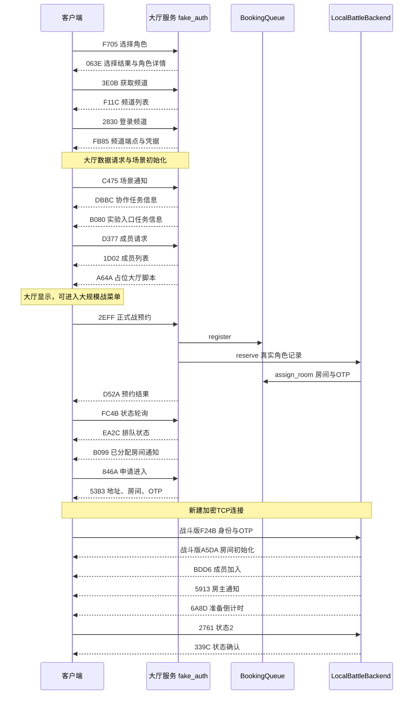

# 从角色选择到大规模战准备房间：技术通路与关键数据

整理日期：2026-11-01。基线：当前中国客户端研究代码，文档整理前提交 `2460c98`。

本文覆盖角色选择成功、频道与大厅初始化、正式战预约、凭据交接及准备房间登录。战场加载仅说明与准备房间的边界，不展开实体出击和战斗模拟。

## 1. 当前实现与证据边界

当前通过 `--hangar-experiment gm` 启用本地准备房间后端；普通模式保持隔离。认证、休息室、战斗服务共用监听端口，通常为 `30000`，通过登录正文区分服务阶段。进入战斗房间会建立新的 TCP 会话，共用端口不表示复用大厅连接。

这是每个机师独立分配房间的本地实验实现，尚无真实104人匹配、战斗实体和伤害结算。界面显示52对52仅表示配置已被读取。

历史记录中已有用户确认进入大厅、准备房间3D背景和真实角色显示成功；后续记录也确认战术图、预览图及52对52/20分钟显示正常。旧笔记中“准备大厅尚未确认”的描述已被后续实测取代。本次文档整理只核对源码与记录，没有重新启动客户端。

## 2. 通路总览



图中大厅初始化展示的是关键依赖，不表示所有初始化请求都按图中的固定时序单独发包。多条消息可以合并在同一明文流中；`B080` 仅实验模式发送，`A64A` 由场景通知后的成员请求触发。

## 3. 角色选择与频道登录

以下长度均为正文长度，不含操作码、内层消息头和外层加密帧。整数按实现使用小端；`NUL` 表示以零字节终止的紧凑字符串。

| 请求→响应 | 关键结构 | 作用 |
|---|---|---|
| `F705 → 063E` | 请求：troops u32、pilot_id u32、skip u8；响应29567B | 保存当前选中角色，返回详情和初始化状态 |
| `3E0B → F11C` | count u32 + count×54B频道记录 | 当前提供一个本地频道 |
| `2830 → FB85` | result/channel、host NUL、port、world、pilot、OTP NUL | 提供频道连接信息 |

### 3.1 角色详情的版本差异

`063E` 包含29514B的 `pilot_detail`，当前不能使用旧参考版51672B详情。前缀、尾部、数组及最后额外读取的u16必须完整，否则客户端游标无法到达正文末尾。

- 详情开头是经验值 `exp`，不是角色ID；当前初始化为100。
- `tuto_step=1` 表示教程结束；填0会进入当前尚未提供的教程加载路径。
- `is_processing_comeback=0`；非零会影响大厅入口等待条件。
- GM实验详情中的编队COST容量为1200，属于本地实验设置。

### 3.2 频道数据与已知限制

频道记录为54B，当前type字段在偏移41取4。旧代码注释曾将它直接解释为场景号；后续场景链路分析已纠正，不能据该字段单独推导场景创建。

`FB85` 字段顺序由 `channel_login_body` 构造，host和OTP按NUL字符串传输，容量上限不是线上填充长度。

当前处理 `2830` 时仍调用 `channel_login_body(channel_id, 1)`，即角色号硬编码为1；大厅成员也直接取第一条有效保存记录。这是多角色支持限制，单角色成功不能证明角色身份在所有环节都已完整贯通。

代码：[fake_auth.py](../server/fake_auth.py)，重点函数 `pilot_select_body`、`channel_entry`、`channel_list_body`、`channel_login_body` 及F705/2830处理分支。

## 4. 大厅初始化与白屏闸门

选角成功后，客户端还会请求战绩、成员、仓库、机体、任务、活动等数据。当前大量业务使用合法空列表或占位结构；它们满足读取器不代表业务已经恢复。

### 4.1 最关键的DBBC推送

实测白屏时主菜单已经创建：`game_state=9`、`scene_id=6`，但主菜单任务停在等待任务信息的步骤。

关键链路为：

```text
C475 场景通知
  → 服务端主动推 DBBC
  → 客户端解析器 ACD84E
  → vt+134 → AF66F0 → A50150 → 43F170
  → game+312B0 = 1（mission_ready）
  → 主菜单任务继续淡入和显示
```

`DBBC` 正文为三组 `4×u64` 加一个u8，严格97B，没有result或count。当前以全零协作任务位图占位。它是场景初始化推送，不是C475的同操作码直接应答；不能跟随成员轮询重复发送。

### 4.2 成员、机库和脚本

| 请求/推送 | 当前数据 | 注意事项 |
|---|---|---|
| `D377 → 1D02` | is_simple、world_client_num、count，各u32；随后成员记录 | 无result；单条角色记录157B，复用创建记录 |
| `16AC → 2ACF / A832 / FCE6` | 28B初始化头、逐台机体、结束消息 | FCE6正文必须为空；sort_type=0会触发空排序结果问题，当前取1 |
| `C475 → B080` | 两个u32计数数组、三个u8标志 | 实验模式提供大规模战入口任务信息 |
| `A64A` | src NUL、val1 u32、val2 u32 | 当前脚本为test_lobby_scr_0.nut，属于占位 |

`game+0x1061C` 是等待窗口，不是场景管理器的场景指针。真正场景管理器从全局 `0x1161F7C` 读取；排查白屏时要区分等待窗口、真实scene_id和任务步骤。

代码：[hall_replies所在文件](../server/fake_auth.py)。回归证据：[test_hall_mission_init.py](../server/test_hall_mission_init.py)。场景纠错：[白屏-场景链路纠错](../server/白屏-场景链路纠错-2026-10-28.md)。

## 5. 大规模战任务与资源关联

入口任务信息、任务CSV与客户端资源各有用途，不能只让按钮可点就认为地图配置完整。

| 项目 | 当前值 | 含义 |
|---|---|---|
| 入口诊断任务 | 900001 | B080当前列出的诊断入口，不能作为可玩房间任务 |
| 准备房间任务 | 30110100 | PREPARATION_MISSION_ID；已替换早期900002 |
| 地图ID | 100102 | 任务CSV列5及房间登录map_id |
| 预览图索引 | 100101 | 任务CSV列1 |
| 地面环境 | 1 | CSV列13 |
| 规则 | VS_TEAM_DEATHMATCH / RPOST_DIFF / ALL | CSV列16/17/18 |
| 倒计时显示条件 | CSV列23为0 | 当前任务读取路径要求该标志不置位 |
| 每队人数 | 52 | CSV列39，不能填总人数104 |
| 时长 | 20分钟 | CSV列40，不能填秒数1200 |

客户端读取的图片关系：

```text
任务30110100 → interface/icon/mission/map/30110100*.dds
列1=100101   → interface/icon/mission/image/100101.dds
列5=100102   → 地图配置、名称及相关资源
```

图片来自客户端本地资源，服务器发送索引。准备房间的任务名称/描述和部分字段仍是本地实验配置，没有恢复原版完整任务脚本。配置人数不等于实际参战人数。

代码：[xwar_entry.py](../server/xwar_entry.py)，重点 `mission_info_body`、`table_body`。图片纠错：[准备大厅图片与倒计时](../server/准备大厅图片与倒计时-2026-10-31.md)。

## 6. 正式战预约与房间凭据交接

| 消息 | 正文结构/长度 |
|---|---|
| `2EFF` 预约请求 | 7×u32，28B；当前后端仅实现matching_type=0的普通单人路径 |
| `D52A` 预约结果 | 25B；混合u32/u8/u16，不能按全u32处理 |
| `FC4B` 状态请求 | matching_type u32，4B |
| `EA2C` 状态响应 | 7×u32，28B：matching、active、room_count、双方预约数、remain_count、remain_seconds |
| `B099` 房间通知 | 4×u32，16B：matching、room_id、wait_seconds、mission_id |
| `846A` 进入请求 | matching、room_id，8B |
| `5383` 进入结果 | result、matching、host NUL、port、room_id、OTP NUL |
| `BEDC → 736E` 取消 | 请求matching u32；响应result/matching两个u32，8B |

处理步骤：

1. `BookingQueue.register` 按 `(account, pilot_id)` 保存预约；相同预约保持幂等。
2. 大厅从存档找到该角色的真实157B记录，取偏移29的阵营，不根据未确认请求字段猜测阵营。
3. `LocalBattleBackend.reserve` 校验记录长度、角色ID和阵营，创建房间与OTP。
4. `assign_room` 只接受已存在、匹配类型相同的预约，并绑定已就绪房间。
5. 下次FC4B响应先发送EA2C，再向拥有者附带一次B099；不在预约结果中伪造“已经进入房间”。
6. 846A核对拥有者、匹配类型和房间号，成功才返回5383端点与凭据。

`D52A` 不包含排队条的剩余人数/等待秒数，这些来自EA2C。零估计仍可能被客户端显示为“立即参战”，不能把该文案当作真实匹配完成证据。

5383中的host最多128个ASCII字节、OTP最多40字节，线上采用紧凑NUL串。失败分支也要提供读取器要求的完整字段结构。

代码：[BookingQueue与BattleRoom](../server/xwar_entry.py)、[LocalBattleBackend](../server/local_battle.py)。

## 7. 战斗登录与准备房间首发数据

### 7.1 新会话与OTP校验

客户端取得5383后新建加密TCP连接，发送战斗版F24B：

```text
user_id u32 | world_id u32 | pilot_id u32 | room_id u32
OTP NUL（最多40字节） | comeback u8
```

正文最多58B。当前OTP由 `secrets.token_hex(20)` 生成，为40字符随机值。身份绑定user/world/pilot/room，待登录有效期300秒，使用constant-time比较，禁止已连接凭据重复占用。

房间、预约和OTP保存在内存中，不写入角色或机库存档。重启失效；取消预约使原房间关联失效；战斗退出/断开清理预约和房间。同一监听端口必须正确识别认证、休息室、战斗版F24B，避免给战斗连接发送休息室短A5DA。

### 7.2 首发顺序

```text
A5DA（战斗房间登录结果）
 → BDD6（本机成员加入）
 → 5913（房主通知）
 → 6A8D（显式配置时的倒计时；当前CLI默认30秒）
```

战斗A5DA共19字段，正文长度为 `632 + 房间名ASCII字节数`：

```text
result / room_id / room_name NUL
mission_id / extrule_id / dc_node_id / map_id
is_vsclan / comeback_stat / is_playing / is_netcafe / team / is_practice
config / progress / expup_fgauge / is_ev_caravan / flag_wideuse
extrarule_xwar_info
```

其中config为34B、progress为46B、extra为514B。当前中国客户端没有旧参考版的额外 `is_rankerbattle u32`，多发会导致后续字段错位。

BDD6成员正文严格179B：

```text
team u8 / troops u8 / world u32 / pilot_record 157B / stat u32
commander u8 / audience u8 / index u8 / order u8 / kill u32 / death u32
```

必须复用真实157B角色记录，不能套旧参考版159B。5913为world/pilot两个u32；6A8D只有秒数u32。账号、角色、世界、房间四种身份不能混用。

代码：[local_battle.py](../server/local_battle.py)，重点 `auth_identity`、`authenticate_body`、`member_body`、`LocalBattleBackend.authenticate`。

## 8. 房间内状态及后续边界

| 请求→响应 | 当前要求 |
|---|---|
| `2761 → 339C` | 状态请求u32；响应result/world/pilot/stat四个u32；接受状态0/1/2 |
| `9B19 → 0B3E` | 成员位置更新，按当前处理器应答 |
| `D97D → 14C5` | 退出；14C5正文为空，不能附加result |

状态2是当前客户端进入房间后自动发送的状态，不能只接受0/1。“确认出击机体”用于编队调整，状态1不应触发开战。

当前CLI默认 `--battle-countdown 30`，以服务端monotonic时钟推进。战斗连接收包超时为0.25秒，单连接线程检查到期并连续推进加密序号；空闲或持续收包时都应检查计时。到期只发送一次7206/1365，取消/断开后不发送。F741不能跳过倒计时。

7206/1365属于后续场景初始化边界。准备房间显示、倒计时归零、战场初始化、实体生成、可操作出击和伤害模拟是不同验收项。

后续纠错：[战场加载接入](../server/战场加载接入-2026-10-31.md)。

## 9. 实现经验与排错顺序

1. **先确认服务阶段和连接。** 检查是否建立新战斗连接、F24B被哪条分支识别、A5DA是否为对应版本。
2. **严格检查包体。** 长度是正文还是整帧、紧凑NUL串、数组计数、空正文、游标结束都要匹配当前读取器。
3. **逐条处理同帧消息。** 客户端会合并多个请求；未知或无需应答消息不能导致其他消息被整体丢弃。
4. **连续维护每连接加密状态。** 主动推送和正常应答共用下行序号；不要中途归零，新TCP会话重新建立状态。
5. **按状态闸门排查白屏。** 检查scene_id、任务步骤、mission_ready及首个资源错误，不能只看等待窗口还在不在。
6. **区分成功层级。** 预约成功检查D52A；房间就绪检查B099；交接检查5383；战斗登录检查A5DA/BDD6/5913；UI/模型需实际客户端证据。
7. **追踪身份一致性。** 多角色环境先审查FB85硬编码、成员选择和selected_pilot_id，避免把角色1的成功泛化。

建议日志检查顺序为 `[xwar] local preparation room allocated` → B099 → 846A → 5383 → 新连接F24B → `[battle] authenticate accepted` → A5DA/BDD6/5913 → 状态2/339C。记录日志时脱敏账号和OTP。

## 10. 验证依据与复现入口

| 层级 | 本文依据 | 本次整理是否执行 |
|---|---|---|
| 源码审查 | 当前fake_auth/xwar_entry/local_battle及研究记录 | 已执行 |
| 编译/构建 | 本次没有修改运行代码 | 未执行，不作为本次验证结论 |
| 自动测试 | 历史报告53项服务端、39项原生解码测试通过 | 本次未重跑 |
| 服务启动与TCP集成 | 历史smoke_local_battle.py独立进程与合成客户端流程通过 | 本次未重跑 |
| 数据库迁移 | 当前使用JSON与内存，无数据库迁移 | 不适用 |
| 原版客户端E2E | 历史用户实测大厅、准备房间背景和角色、图片/人数显示 | 本次未重新操作；不代表多人匹配和战斗验证 |

相关测试入口：

- [大厅任务初始化测试](../server/test_hall_mission_init.py)
- [预约与交接测试](../server/test_xwar_queue.py)
- [准备房间与TCP测试](../server/test_local_battle.py)
- [原生预约解析测试](../tools/test_xwar_booking_native.py)
- [原生战斗房间解析测试](../tools/test_battle_room_native.py)
- [独立服务TCP冒烟](../tools/smoke_local_battle.py)

原生测试需要Unicorn和本地私有客户端映像；它执行读取器，不覆盖完整UI回调和资源加载。TCP冒烟使用合成客户端，且没有覆盖真实UI的完整选角过程，不能将其称为从点击选角到进房的原版客户端E2E。

## 11. 研究记录阅读顺序

1. [大厅场景链路纠错](../server/白屏-场景链路纠错-2026-10-28.md)：大厅白屏和DBBC突破。
2. [正式战房间链路](../server/正式战房间链路-2026-10-31.md)：预约轮询与交接结构。
3. [准备大厅接入](../server/准备大厅接入-2026-10-31.md)：战斗登录、成员与OTP。
4. [图片与倒计时续接](../server/准备大厅图片与倒计时-2026-10-31.md)：进入准备房间实测和资源纠错。
5. [战场加载接入](../server/战场加载接入-2026-10-31.md)：最新倒计时触发规则。

旧文档中的900002、尚未进入准备房间、准备状态1触发加载、没有倒计时CLI等是阶段状态，以当前代码和后续明确纠错为准。
