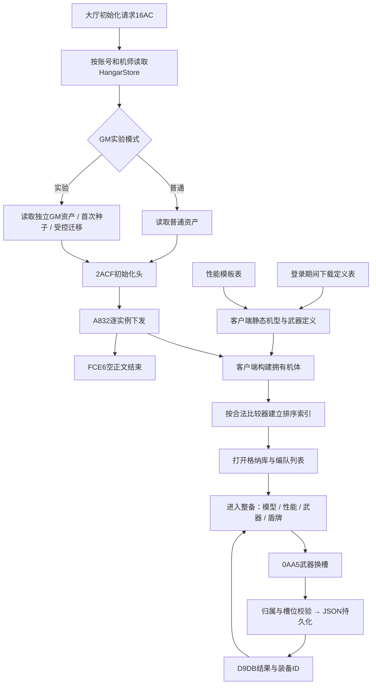

# 格纳库与机体系统：技术通路及关键数据

整理日期：2026-11-01。本文依据当前 `fake_auth.py`、`hangar.py`、`hangar_experiment.py` 和相关研究记录，覆盖大厅预加载、格纳库列表、整备模型、性能、武器、盾牌、编队与持久化。与[选角到准备房间](HALL_TO_BATTLE_ROOM.md)配套阅读。

## 1. 总体认识与当前范围

**机体数据在大厅初始化阶段已经下发，点击格纳库主要消费客户端已建立的资产、定义和排序结果，并非每次点击都重新请求机体列表。**

机体系统分成四层：

| 层 | 数据 | 作用 |
|---|---|---|
| 持有资产 | A832中的机体与武器记录 | 这名机师拥有哪些实例、装了什么、编入哪个槽 |
| 静态定义 | msma_settings、item、weapon_settings等表 | 机型身份、武器集合、资源索引与性能引用 |
| 性能模板 | msma_battle_detail、weapon_battle_detail | 将模板名解析成基础数值及内部参数 |
| 客户端资源 | DXG、DDS、VRA、MRB | 几何、贴图、材质描述与动画 |

收到一条A832、读出名称、显示图标、渲染模型、换装成功和可用于战斗，是不同验收层。当前是可选的GM关联实验，尚无完整编队编辑、强化结算和战斗系统。

历史用户实测已确认吉姆条目、预设编队第一槽、整备入口和3D模型；武器名称、槽位、重量和威力也有实际显示证据。新增性能维度、盾牌最终面板和真实换装重登的验证范围要分别判断，不能统一称为全部完成。

## 2. 通路总览



定义表与持有资产必须都具备。普通模式不会因为存在模型文件就自动授予机体；GM模式通过显式开关 `--hangar-experiment gm` 使用独立资产存储。

## 3. 机体初始化协议与排序故障

消息顺序：`16AC → 2ACF → A832×N → FCE6`。以下长度均指正文，不含操作码及加密帧，整数按当前实现使用小端。

### 3.1 2ACF：28B初始化头

```text
sv_time u32 / slot_num u16 / sort_sec u32 / sort_usec u32
penalty u16 / bonus u16 / balance u16 / sort_type u32 / sort_order u32
```

**`slot_num` = 本次下发的 `0xA832` 记录条数，不是仓库容量。** 依据三条：
① 客户端自己的日志串把这个字段叫 `slot_num`，且整帧是 `recv_msma_init_get_r_begin`
（处理器 `0xAAA848`，`push 0x1c` 预留正好 28B，读取顺序与本表一致）；
② 它和另外 8 个字段一起被交给 `vt[0x21c]`（`0xAAAC89`），handler 内部不拿它循环；
③ 9.0.0.235 上的单变量实验：只改这一个 u16，填 `max(100,n)` 必崩、填 `n` 正常。

本实现按条数下发（空仓库自然是 0）。⚠️ 5.0.0.33 对**偏大值**不敏感（长期用 100
跑通过），所以那两个现象不矛盾——但"容量至少 100"这个旧说法是错的，已改掉；
如果哪个 build 真按它迭代，只有"条数"能用。详见 `server/答复-三处代码与文档不一致-2026-11-01.md`。

sort_type位于正文偏移20，sort_order位于24，当前分别为1/0。

曾经begin全零导致列表闪退：比较器选择函数 `0x604830` 只接受排序类型1..13、顺序0..1。类型0使 `0x5E0600` 不填排序向量，`0x787BB6` 随后解引用空对象。这发生在模型读取之前，不能靠修改模型号解决。

### 3.2 A832：资产主体

```text
unit_record 299B
weapon_count u32（当前最多30）
weapon_record 30B × weapon_count
equipset_count u32（读取器 0xA96750，上限按装备界面 4 格 × 2 页 = 8）
equipset_record 121B × equipset_count   ← 「装备记忆」存下来的装备组，见 10.1
```

因此套装数0时，正文长度为 `307 + 30×武器数`；三件持有武器时为397B。带 `k` 个装备组时再加 `121k`。
盾牌是独立装备字段，当前不作为第四件MAIN武器加入该列表。

装备组必须跟着 A832 一起下发，否则「装备记忆」只在本次会话内可见，重登就丢了。

`FCE6` 是列表结束标记，正文严格为空。初始化头、全部资产及结束标记缺一都可能影响客户端状态。

实现：[fake_auth.py](../server/fake_auth.py) 的 `hall_replies(0x16AC)`；编码：[hangar.py](../server/hangar.py)。历史故障：[格纳库列表闪退](../server/格纳库列表闪退-2026-10-29.md)。

## 4. 299B机体记录与30B武器记录

### 4.1 机体wire关键偏移

偏移均为十进制，且相对线上299B记录；不能直接当作客户端拥有对象内存偏移。

| 偏移 | 类型/长度 | 字段 |
|---|---|---|
| 0 | u64 | uniqid，资产实例ID |
| 8 | u32 | msma_id，机型定义ID |
| 12 / 16 | u32 / u32 | tm_sec / tm_usec |
| 20 | 61B区域 | nickname，当前截取最多60个UTF-8字节并保留终止空间 |
| 81 | u32 | 当前电量energy |
| 85 / 89 | u32 / u8 | decal / color |
| 90 / 91 | 两个u8 | 两套编队槽位deckslots |
| 94 / 98 | u32 / u32 | cost / mission_cost |
| 102 / 106 / 110 | 三个u32 | 三个已装备武器item_id |
| 114 / 118 | u32 / u32 | shield / special |
| 190 | u16 | buildup_count |
| 192 | 7×u16 | up_params |
| 206 | 7×u16 | develop_params |
| 290 / 292 | u16 / u32 | msbits / unlocked_colors |
| 298 | u8 | favorite |

未列出的区域当前多为零，不等于其业务含义已恢复。读取器为 `0xA96070`；线上偏移102的武器数组读取后落入另一套内存布局，排错时必须注明是哪种偏移。

### 4.2 武器wire

`weapon_wire` 使用 `<IHH10HBB`，共30B：

```text
item_id u32 / db_index u16 / buildup_count u16
buildup_values 10×u16 / ticket_success u8 / ticket_greatest u8
```

读取器为 `0xA964D0`。db_index与item_id不同；持有武器列表与三个装备槽也不同，前者表示可用资产，后者表示当前配置。

结构映射：[机体wire映射](../server/hangar_msma_wire_map.json)、[武器wire映射](../server/hangar_weapon_wire_map.json)。

## 5. 身份、模型与资源关联

| 身份 | GM实验值 | 含义 |
|---|---|---|
| uniqid | 777000000001 | 这一台持有机体的实例 |
| msma_id | 777001 | 本地实验机型定义 |
| model_id | 101010101 | 模型资源与模型参数定义 |
| Wiki修订 | 吉姆revision103423 | 参考平衡数据来源，不是客户端机型ID |

关键链路：

```text
A832.msma_id = 777001
 → msma/msma_settings.csv col0=777001
 → col1=101010101
 → msma/msma_model.csv对应模型参数
 → chara/01/01/0101/model/MSM_0101_0101_01.dxg
 → 对应材质与DDS贴图
```

当前机型行92列、模型参数行32列。机型读取器 `0x54EF50`，拥有对象构建 `0x5DEB20`；后者查机型定义后复制模型ID。模型比例等参数仍有诊断占位，模型能显示不等于镜头和比例已经还原。

资源号的编码、皮肤和扩展贴图不能靠目录相似度推定身份；详见[数据集说明](DATASETS.md)和[用户确认的模型贴图规则](../server/模型与贴图命名规则-用户确认-2026-10-31.md)。

## 6. 机体性能：定义引用模板，再由加载收尾绑定

`msma_settings.csv` 不直接存全部最终面板值。`0x54E830 → 0x54E2F0` 根据模板名查询性能表，再补齐机型内部结构；找不到模板会置零。

真正模板加载入口为主vtable的 `+8=0x9B1B30`，行回调 `0x9AC5F0`。旧研究曾把vt+0的枚举查询当成加载器，该解释已撤回。

| msma_settings列（从0计） | 引用/数据 | 当前GM设置 |
|---|---|---|
| 56 | RESPAWN_TIME模板 | 11档均50，档位规则尚未恢复 |
| 58 | WARP_TIME模板 | 10，诊断占位，不是Wiki归投性能682 |
| 60 | COST模板 | 200 |
| 62 | MAX_HP模板 | 3425 |
| 64 | ENERGY模板 | 100、0两个整数；第二值语义未恢复 |
| 67 / 73 | MOVE / BOOST_SPEED模板 | 按当前UI倍率校准显示速度1004 |
| 69 / 71 | BOOST_GAUGEMAX / BOOST_GAUGEHEAL | 1000 / 200 |
| 79 | JUMP模板入口 | 当前未填专门GM跳跃模板 |
| 52 | PAYLOAD直接值 | 1450 |
| 9 / 10 / 11 | 地形相关字段 | 1 / 0 / 1，当前支持地面和宇宙、不提供水中适应 |

模板CSV结构为 `类型文本,模板名,参数...`。内部运动值不是Wiki面板速度：当前MOVE为 `1004×1680/2000=843.36`，BOOST_SPEED使用中性倍率；加速度等大量参数仍为零诊断值。

这些值是选定Wiki修订的参考平衡及本地兼容配置，不是已恢复的当前客户端原版战斗参数。

## 7. 武器定义、图标与性能闭环

三条关系必须同时成立：

```text
可装备集合：msma_settings col38 → msma_weapon_set col0分组 → col2 item_id
持有与装备：A832.weapons → item_id；equipped_weapons[0..2] → 当前槽位
名称与性能：item.csv → weapon_settings → weapon_battle_detail / bullet / buildup
```

### 7.1 当前实验武器

**默认授予（starter，新建机体直接持有并装备）**

| item_id | 名称 | 类型/动作 | 重量 | 参考威力 | 弹数 | 资源号 |
|---|---|---|---|---|---|---|
| 777101 | 光束喷枪 | SHOTGUN / GUN_SINGLE | 320 | 1000 | 5/20 | 02010501 |
| 777102 | 光束军刀 | WRESTLE / WRESTLE | 240 | 3500 | 不适用 | 04010101 |
| 777103 | 手雷 | HAND_THROW / HAND_THROW | 130 | 6500 | 1/7 | 10020101 |

**追加测试武器（只下发定义，不自动授予，必须解锁）**

| item_id | 名称 | 类型/动作 | 重量 | 参考威力 | 弹数 | 资源号 |
|---|---|---|---|---|---|---|
| 777105 | 光束喷枪·改 | SHOTGUN / GUN_SINGLE | 300 | 1200 | 6/24 | 02010301 |
| 777106 | 光束军刀·改 | WRESTLE / WRESTLE | 250 | 3800 | 不适用 | 04010301 |
| 777107 | 手雷·改 | HAND_THROW / HAND_THROW | 140 | 6800 | 1/8 | 10090101 |
| 777108 | 散弹枪 | SHOTGUN / GUN_SINGLE | 280 | 900 | 8/32 | 02010601 |

starter 总重690，低于实验载重1450。参考值在 [gm_starter_weapons.json](../server/reference/gm_starter_weapons.json) 与 [gm_test_weapons.json](../server/reference/gm_test_weapons.json)。
追加武器的资源号都核对过 `interface/icon/item/d/d%08d.dds` 与 `item/%02d/%04d/attr/EZ_*.vra` 同时存在；
类别/动作只复用原生枚举里已验证过的 `SHOTGUN / WRESTLE / HAND_THROW`，没有引入未验证枚举。
原生类别枚举没有BEAM_SPRAYGUN，所以喷枪使用SHOTGUN；动作类别不等于完整攻击动作配置。

### 7.1.1 武器解锁与持久化

"解锁"在数据层就是**把武器写进机体的持有列表** `unit['weapons']`：

```text
可装备集合：msma_weapon_set（下发，全部 7 把）
持有/解锁：A832.weapons（存档里，决定列表里哪些可选）
当前装备：equipped_weapons[0..2]
```

操作入口：`tools/unlock_weapon.py`（默认只动 `server/saved_hangar.gm.json`）。

```powershell
python tools/unlock_weapon.py --list --account 123 --pilot 1
python tools/unlock_weapon.py --account 123 --pilot 1 --uniqid 777000000001 --item-id 777105,777108
python tools/unlock_weapon.py --account 123 --pilot 1 --uniqid 777000000001 --item-id 777105 --lock
```

- **期望初始状态：starter 三把已解锁，追加的四把未解锁。** 四把一起解锁过会让它们全部可选，与"留几把做解锁实验"的意图不符，所以提供 `--lock` 回退；
- 解锁幂等（已持有直接跳过，不写盘）；`--lock` 把武器从持有列表移除，并**清掉引用它的装备槽**（否则 `equipped ⊆ owned` 校验会拒绝写入）；
- `db_index` 取该武器在 `all_definitions()` 里的下标，与 `msma_weapon_set` 下发顺序一致；
- 落盘走 `replace_units` 的临时文件 + 原子替换，重启服务/重登后仍在；
- 单机体持有上限 30 条（`unit_add_body` 的原生约束），满了会拒绝。

**游戏内「开发」按钮已接，且能原地刷新**（2026-11-01 实测通）：

```text
客户端 → 0x550A msma_weapon_unlock        正文 20B
         uniqid_ms u64 | item_id u32 | use_gp u32 | use_bc u32
服务端 → 解析 → 写进 unit['weapons'] 落盘 → 回 0x45E4 msma_weapon_unlock_r
         正文 17B（必须恰好 17，多一字节即静默丢弃）
         result i32 | uniqid_ms u64 | item_id u32 | db_index s8
```

实测：点「开发」= 当场解锁，**不用重登**。存档同步多出该武器，重登后仍在。

**0x45E4 正文布局的推导依据**（`server/fake_auth.py::unlock_reply_body`）：

| 地址 | 读取原语 | 字段 | 宽度 |
|---|---|---|---|
| `0xAAE0FD` | `0xA5A270 claim_u32` + `0xA5A310 read_u32` | `result` | 4 |
| `0xAAE134` | `0xA94620 claim 8` + `0xA5D7C0 read_u64` | `uniqid_ms` | 8 |
| `0xAAE174` | `0xA5A270 claim_u32` + `0xA5A310 read_u32` | `item_id` | 4 |
| `0xAAE198` | `0xA5D400 claim 1` + `0xA5A360 read_u8` | `db_index` | 1 |

两处独立佐证都指向 17：

- `0xAAE0D1` 是 `push 0x11; call session->vt[0x78]`，和四个 send 函数里的
  `push 0x16`（0x550A/0x34AB/0xA28F 正文 20B）、`push 0x12`（0x2E33 正文 16B）
  是同一个方法（申请定长正文），`0x11 = 17`；
- `0xAAE1BC` 是 `mov eax,[esp+0x14]; cmp eax,[esp+0x18]; jne error(0x110,1)`
  —— 游标必须等于 end，**正文被多读/少读都走静默 error 分支**。
  之前回 34B（`result | id | 0 | uniqid | item_id | db_index | u8 | u8`）就是这个原因无效：
  字段整体错位一格，客户端把 item_id 当成 uniqid、把 uniqid 低 32 位当成 item_id。

拿到字段后处理器把 5 个值交给 `vt[0x2c4](result, uniqid_lo, uniqid_hi, item_id, db_index)`
（`0xAAE336-0xAAE34B`），机库模型和列表刷新都在那个回调里完成，所以不需要额外推任何包。

**关联的三段式报文（本 build 都有发送端，但「开发」按钮只走第一段）**

| opcode | 发送函数 | 正文 | 说明 |
|---|---|---|---|
| `0x550A` | `0xAE4100` `send_msma_weapon_unlock` | 20B | 「开发」实际发的就是它，`use_gp/use_bc` 决定扣哪种币 |
| `0x34AB` | `0xAE4380` `send_msma_weapon_unlock_estimate` | 20B | 估价，本流程未触发 |
| `0xA28F` | `0xAE4630` `send_msma_weapon_unlock_complete` | 20B | 确认，本流程未触发 |
| `0x2E33` | `0xAE48C0`（日志串在 `0xE12FF4`） | 16B | 同上 |

`use_gp = use_bc = 0` 就是免费解锁，不必再做货币同步。

⚠️ 接入新请求时务必先把 opcode 加进 `fake_auth.HALL_OPS`：
分发前有一道 `any(op in HALL_OPS ...)` 的闸门，不在白名单里的帧会被**整帧静默丢弃**，
连"未知 opcode"都不会打日志。

⚠️ `0x45E4` 在 `server/lounge_dispatch_table.json` 里记的是 `00AD5E25`（默认分支），
那是枚举器只认首级二分表造成的误标。真实分派在 `0xAAE07D` 起的二级比较链上：
`cmp eax,0x48A4 / 0x4632 / 0x44D4 / 0x45E4`，`0x45E4` 命中后**顺序落到** `0xAAE0B5`
（没有跳转指令指向它，所以按跳转目标搜是搜不到的）。

### 7.2 weapon_settings关键列（从0计）

| 列 | 用途 |
|---|---|
| 0 | 武器主键，与item.csv的WEAPON物品关联 |
| 2 / 3 / 4 | 基础及状态资源号；col2还被图标消费方使用 |
| 21 / 30 | 类别枚举 / 动作枚举 |
| 64 | develop/buildup_weapon属性显示组 |
| 68 | bullet引用 |
| 74 / 77 / 81 / 88 / 90 | POWER / RANGE / STABILITY / RELOAD / LOCKON_CAM模板 |
| 101 / 102 | 弹匣 / 备弹 |
| 109 | 重量，写武器结构+0x7C4 |

当前weapon_settings为134列。不能把item.csv col1猜作图标或模型号。

### 7.3 面板倍率与依赖

| 项目 | 当前内部输入→参考显示 |
|---|---|
| POWER | 100/350/650 → 面板×10得到1000/3500/6500 |
| RANGE | 喷枪30 → 解析×100、UI×0.1 → 300 |
| STABILITY | 喷枪1、1 → 解析反序×100、UI `(500-value)×2` → 800 |
| RELOAD | 喷枪3.2、手雷2.4 → UI `(10-raw)×100` → 680/760 |
| LOCKON_CAM | 78/74 → 解析×0.01、UI×1000 → 780/740 |
| 手雷效果范围 | bullet列11=600 → UI除1200再乘10000 → 5000 |

属性显示标记来自 `develop/buildup_weapon.csv`，并非有性能模板就自动显示。RANGE等路径会访问bullet对象，缺依赖可能空指针。bullet目前仅补充详情元数据，飞行、碰撞及特效未恢复。

强化预览还依赖 `develop/mechanic_weapon.csv` 的BUILDUP_GREATEST行。该表读取20个交错上下界参数，当前保守填零。它不是 `mechanic_ticket.csv`：将数据下发到错误表曾导致7A68BB崩溃；数字2也不能替代真实文本枚举BUILDUP_GREATEST。

### 7.4 图标与3D资源

图标经 `weapon_settings col2 → weapon+4 → 558110 → A317F0/A318F0` 格式化为 `interface/icon/item/d/d%08d.dds` 或 `s/s%08d.dds`。

当前喷枪/军刀/手雷资源号分别为02010501、04010101、10020101。它们是按本地外观选择的实验引用；不证明原版吉姆武器变体正确。

武器动作加载 `4E2570` 根据状态选择col2/3/4，再生成 `item/%02d/%04d/attr/EZ_%02d_%04d_%02d.vra`，动画路径使用EA前缀MRB。当前三个状态重复基础资源，避免备用状态取0；没有恢复专用收刀/拔刀姿态。

机体公共动画来自 `chara/01/01/anim/MSA_0101_%05d.mrb`，不一定放在具体机体0101/anim下。挂点、攻击时刻、格斗命中窗、枪口及爆炸特效仍未恢复。

## 8. 盾牌：独立装备及机型支持字段

当前盾牌item_id为777104，参考耐久990，资源号12010101。

```text
机体实例wire偏移114：eqshield_itemid=777104
机型msma_settings col44=777104 → 机型结构+0x16C
item.csv WEAPON → weapon_settings类别/动作SHIELD
weapon_settings col97 → SHIELD,GM_SHIELD_HP,990,0
```

仅填实例盾牌ID不足以让机体面板显示耐久。面板路径还查机型col44、武器定义和SHIELD支持位，最终直接显示990，不乘10。线上偏移114写的是装备ID，不能写耐久990。

盾牌不占三个MAIN槽，也未向msma_weapon_set编造SHIELD组分类。当前独立盾牌重量取0，不臆测未知重量；选择列表、正式换盾协议、格挡/破盾/修复和战斗伤害未验证。

## 9. 编队、COST、电量与候选过滤

- `deckslots=[0,0]` 表示地面、宇宙两套编队各自第一槽；255表示未编入。不是同一编队占两个槽。
- 当前只有一个uniqid，已经编入该套编队时，会被该编队新增槽候选过滤；第二槽没有吉姆不等于丢失资产。要同时占第二槽需另一个独立实例。
- 实例COST在wire偏移94，机型COST来自模板；编队容量另在 `063E` 的pilot_detail偏移24（整体正文偏移52，u16），实验为1200。仓库slot_num不能替代它。
- 两套编队各占200，不应合并计算为400。实际编队增删/替换协议尚未实现；旧资料F969→D6BC不能直接视为当前已支持命令。
- 电量当前值来自实例wire偏移81；最大值来自ENERGY模板首个整数100。只加当前电量无法解决容量0的问题。战后耗电、充电、扣费未实现。

出击资格至少要区分未编入、当前电量耗尽、超过容量和COST超限；不能据格纳库显示正常宣称资格校验闭环已完成。

## 10. 武器换装与持久化

请求 `0AA5` 正文14B：`uniqid u64 / slot u16 / item_id u32`；响应 `D9DB` 正文18B：`result i32 / uniqid u64 / slot u16 / item_id u32`。

当前 `HangarStore.change_weapon` 按账号与机师查找资产，验证实例存在、槽位0..2、武器属于该实例；item_id=0表示卸下。验证通过后修改equipped_weapons，写临时JSON再replace，最后返回结果。格式正确但业务失败时返回非零结果并回显请求身份；长度错误时不构造伪造成功响应。

当前校验覆盖归属、槽位和持有关系，不等于已实现全部互斥武器、金限、重量、地形与战斗资格规则。

| 存储 | 用途 |
|---|---|
| server/saved_hangar.json | 普通机库 |
| server/saved_hangar.gm.json | GM实验机库 |
| schema_version=1，pilots映射 | 按JSON编码的 `[account,pilot_id]` 作为键保存实例列表 |

16AC只在实验机库为空时建立GM种子；已有存档不会每次重建覆盖。旧无武器种子可受控补齐；盾牌通过gm_shield_revision一次性迁移，保留已有非零盾牌，之后卸为0也不再次补发。迁移只针对指定GM实例。

自动测试已经验证更换后重新读取持久化、账号/机师隔离、拒绝请求不修改文件，以及实验模式重复16AC不覆盖换装；这不同于真实客户端完成换装退出重登的E2E验证。

### 10.1 装备组（「装备记忆」）

装备界面右侧四个按钮分别对应：

| 按钮 | 发包 opcode | 发送函数 | 回包 opcode | 处理器 |
|---|---|---|---|---|
| 换装 | `0xF5AC` | `0xAE5714` `send_msma_equipset_switch` | 待定 | — |
| 装备记忆 | `0x9527` | `0xAE5480` `send_msma_equipset_store` | `0x7172` | `0xAB5F0A` |
| 删除装备组合 | `0xE410` | `0xAE5B34` `send_msma_equipset_del` | `0x8F3E` | `0xABBEDC` |

（全部 219 条发包 / 93 条 lounge 接包见 `server/lounge_send_handlers.md`、`server/lounge_recv_handlers.md`。）

**装备记忆的线上格式**（实测 129B 请求，2026-11-01）：

```text
uniqid_ms u64 | 装备组块 121B
```

装备组块 121B —— 序列化器 `0xA948C0` 与反序列化器 `0xA96750` 字段宽度完全一致：

| 块内偏移 | 类型 | 含义 | 实测值 |
|---|---|---|---|
| `+0x00` | u32 | 未定（像未初始化值） | `0x001AF614` |
| `+0x04` | u32 | 未定 | `0x5CDD4DA8` |
| `+0x08` | u16 | **槽位**（0 基） | 0 |
| `+0x0A` | 3×u32 | 三个武器槽 | 777105 / 777102 / 777103 |
| `+0x16` | u32 | 盾牌 | 777104 |
| `+0x1A` | u32 | 未定 | 0 |
| `+0x1E` | 10×u32 | 未定（附加模块/贴纸等） | 全 0 |
| `+0x46` | u32 | 未定 | 0 |
| `+0x4A` | u32 | 未定 | 0 |
| `+0x4E` | char[43] | 名字（UTF-8，NUL 截止，余下是未初始化垃圾） | `装备组合1` |

⚠️ 注意块内偏移与内存结构体偏移不同：结构体里 u16 在 `+0x08` 后面有 2 字节对齐填充，所以线上 `+0x0A` 才是武器数组，而结构体里是 `+0x0c`。内存块 128B（`0xA93EF0` claim `0x80`），线上只有 121B。

回包 `0x7172` 正文 **133B** = `result i32 | uniqid_ms u64 | 同一个 121B 装备组块`
（`0xAB5FD8` 同样校验「游标 == end」，多一字节即静默丢弃）。

服务端策略：**原样回存 121B 再原样回给客户端**。`+0x00/+0x04/+0x1A/+0x1E/+0x46/+0x4A` 语义未定，
且实测后半段带未初始化垃圾，自己重建容易把客户端绕晕；只把 `+0x08` 的槽位归一化并落盘。

**持久化**：`A832` 的正文尾部就是 `u32 weapon_count | 武器记录 | u32 equipset_count | 装备组记录`，
其中装备组记录使用的正是同一个 121B 反序列化器（`0xAC046A -> 0xA96750`）。
所以装备组会跟着机体一起下发，退出重登后仍在。

存档结构：

```json
"equipsets": [
  {"slot": 0, "name": "装备组合1", "weapons": [777105, 777102, 777103],
   "shield": 777104, "raw": "<121 字节的 hex>"}
]
```

`raw` 是权威数据，`name/weapons/shield` 只是给人看的解码视图。

⚠️ 槽位来源是块内 `+0x08` 的 u16。第一次采样（用户点「装备记忆」）该值为 0，
对应默认名「装备组合1」；需要在**另一个格子**上再存一次来确认它确实随选中格变化。

### 10.2 机体组（「机体设置01」）

「机体组」是把若干台机体编成一组（面板上 机体设置01…）。两条报文：

| 用途 | 发包 | 发送函数 | 回包 | 处理器 | 正文 |
|---|---|---|---|---|---|
| 拉列表 | `0x9A9D` | `0xAE4D99` `send_msma_msset_get` | `0x356F` | `0xAABFB0` | 请求空；回 `u32 count + count×95B` |
| 保存 | `0xA76E` | `0xAE4ED0` `send_msma_msset_store` | `0xB8BB` | `0xAC3EF8` | 请求 95B；回 `i32 + 95B` = 99B |

**机体组块 95B** —— 序列化器 `0xA94770` 与反序列化器 `0xA96600` 字段宽度一致：

| 块内偏移 | 类型 | 含义 | 实测值 |
|---|---|---|---|
| `+0x00` | u64 | 未定（像「新记录」标记） | 0 |
| `+0x08` | u16 | **机体设置编号**（01 => 0） | 0 |
| `+0x0A` | u16 | 组内槽位 | 0 |
| `+0x0C` | char[43] | 名字（C 字符串） | 空 |
| `+0x37` | 4×u64 | 四台机体的 uniqid | `777000000001` / 0 / 0 / 0 |
| `+0x57` | 4×u16 | 未定标志 | 全 0 |

装配验证：`8 + 2 + 2 + 43 + 4×8 + 4×2 = 95`，与实测正文 95B 吻合；
列表回包 reserve `0x784 = 1924 = 4 + 20×96`，正好对应「最多 20 条」的上限
（`0xAAC028` 的 `cmp ebx,0x14; ja` 也印证 20）。

⚠️ 客户端这块的**名字缓冲区没有初始化**，实测 NUL 后面是栈垃圾
（`00 82 99 00 15 02 …`）。服务端按 C 字符串语义处理：截到第一个 NUL，
再把整个 43 字节字段补零；不补零会把乱码原样回给 UI。

⚠️ 之前这两条报文都没接：`0x9A9D` 在日志里出现过 **64 次**全部被
`HALL_OPS` 闸门静默丢弃，所以「机体组」面板一直是空的，点保存也没反应。

存档结构（**按机师存，不挂在机体上**）：

```json
"mssets": {
  "[\"123\",1]": [
    {"index": 0, "slot": 0, "name": "", "ms": [777000000001, 0, 0, 0],
     "flags": [0, 0, 0, 0], "raw": "<95 字节的 hex>"}
  ]
}
```

## 11. 金银图与强化边界

`blueprint_grade` 当前只在JSON中校验gold/silver/rental，并未编码到299B机体记录。客户端显示银图及20次上限，不能证明该JSON字段控制客户端金银身份。

记录中虽有buildup_count、7个up_params和7个develop_params，但7槽不等于界面7项可强化属性，索引与倍率仍需核对。

用户要求保留金图30次、银图20次、有效强化失败也计一次的规则；当前没有实现扣券、GP、随机结算、完整等级计算、重置及追加特性。预览价格回包不能自行追加概率字段，未知概率和增量不能写成原版规则。

详细边界：[机体强化机制核对](../server/机体强化机制核对-2026-10-31.md)。

## 12. 排错与验证口径

推荐按以下顺序排查：

1. 核对普通/实验模式、账号及pilot_id，确认读的是哪份存档。
2. 检查16AC、28B的2ACF、A832数量和FCE6空正文。
3. 列表崩溃先看排序字段和首发异常，不直接归因模型。
4. 核对msma_id→模型/武器组/盾牌/性能模板的完整引用。
5. 性能为0时检查模板名称、加载收尾和单位，而非只改实例字段。
6. 图标与模型分开验证；动作分类与真实动画分开验证。
7. 换装先检查14B请求和18B结果，再检查存档及下一次16AC。

历史737130空指针曾被误判为物品实例容器问题；后续确认1162028是CMissionVsTable，该异常不能继续作为武器持有列表根因。最新明确的武器预览问题应按mechanic_weapon表修复记录理解。

本次文档整理完成源码与研究记录审查；仅修改Markdown，没有编译、测试、服务启动、数据库迁移或原版客户端E2E的新通过结论。文档链接及格式检查单独报告。

可复查的自动测试：

- [资产编码与换装存储](../server/test_hangar.py)
- [GM定义、实验隔离及迁移](../server/test_hangar_experiment.py)
- [原生299B/30B读取器](../tools/test_hangar_native_reader.py)
- [原生排序比较器](../tools/test_hangar_sort_native.py)
- [武器详情依赖](../tools/test_hangar_weapon_detail_native.py)
- [图标消费与性能换算](../tools/test_hangar_weapon_stats_native.py)
- [盾牌字段与显示](../tools/test_hangar_shield_native.py)
- [COST与电量前缀](../tools/test_hangar_readiness_native.py)
- [武器状态资源选择](../tools/test_hangar_action_resources_native.py)

Unicorn测试需要本地私有映像，部分CSV访问器、静态查找、状态虚方法或UI控件由测试替代；通过不代表完整CSV加载、渲染与战斗行为。COST读取测试的镜像详情消费长度与在线版本有差异，仅证明固定前缀，不应据此改动已在线通过的总长度。

## 13. 证据与继续开发入口

主要实现：[hangar.py](../server/hangar.py)、[hangar_experiment.py](../server/hangar_experiment.py)、[fake_auth.py](../server/fake_auth.py)。

研究记录按主题阅读：

- [格纳库性能与武器交接](../server/AGENT交接-格纳库性能与武器-2026-10-29.md)：基础通路；无武器、每次重建等描述已过期。
- [武器续接实证](../server/武器续接实证-2026-10-30.md)：包含多轮过程记录，RELOAD以文首3.2/2.4纠正为准，旧0.68/0.76结论不再适用。
- [武器动作资源](../server/武器动作资源关联-2026-10-31.md)：状态资源选择与尚缺演出。
- [盾牌数据关联](../server/盾牌数据关联-2026-10-31.md)：机型列44及实例盾牌依赖。
- [编队COST与电量](../server/编队COST与电量接口-2026-10-31.md)：容量、当前值与消耗边界。

后续优先补齐当前客户端编队修改协议与资格校验、真实换装重登及新增性能/盾牌的客户端验收，再推进强化经济结算和实际战斗。所有新增定义保留来源、版本、兼容假设和未恢复字段。
